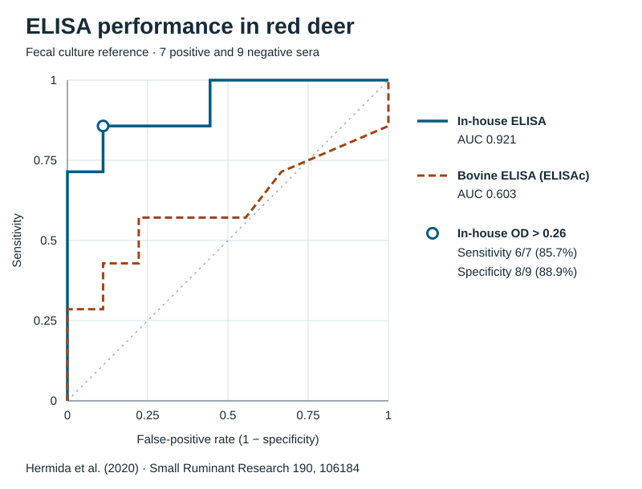

# Comparing two ELISAs for Johne’s disease in red deer

How well did an ELISA developed for red deer distinguish animals with positive fecal cultures from those with negative cultures? Hermida and colleagues tested serum from the same 16 red deer with their in-house assay and a bovine ELISA (ELISAc). This Python reanalysis reconstructs the receiver operating characteristic (ROC) curves in Figure 2 of their paper from the original animal-level measurements. [Hermida et al., *Small Ruminant Research* 190 (2020), 106184](https://doi.org/10.1016/j.smallrumres.2020.106184)

## Reproduce the figure

From the directory containing this README, run the following command with Python 3. The scripts use only the standard library and were tested with Python 3.9.6.

```sh
python3 scripts/plot_roc.py
```

The command reads the included CSV, checks the areas under both curves against Table 2 of the paper, and writes `figures/elisa_roc.svg`.



## Reading the result

In this validation set, the in-house ELISA separated culture-positive from culture-negative animals more clearly than the bovine assay. The area under the curve was **0.921** for the in-house ELISA and **0.603** for ELISAc. At the marked cutoff (optical density **> 0.26**), the in-house assay identified 6 of 7 culture-positive animals and classified 8 of 9 culture-negative animals as negative. These estimates describe the 16 validation animals. The paper’s separate field survey of 155 deer falls outside this analysis.

One culture-negative serum falls exactly on the 0.26 cut-off. Counted as negative, it reproduces the published sensitivity and specificity; counted as positive, it reproduces the published kappa.

This second command prints the confusion matrices and Cohen’s kappa for both cutoff rules.

```sh
python3 scripts/check_totals.py
```

## Data provenance

The [validation CSV](data/elisa_red_deer_validation.csv) contains one row per deer. It includes all 16 sera from the validation study (paper sections 2.3 and 2.7). The culture labels and optical densities come from rows 4–19 of the authors’ original figure worksheet.

| Column | Meaning and source |
| --- | --- |
| `sample_id` | Sample code (S01–S16) assigned for this reanalysis. |
| `fecal_culture` | Reference result for the animal, `positive` or `negative` (worksheet column A). |
| `od_inhouse_elisa` | Optical density at 490 nm for the in-house assay (column C). |
| `od_elisac` | Optical density at 490 nm for the bovine assay (column D). |

The CSV preserves the worksheet values to four decimal places. The worksheet stores the bovine assay readings to two decimal places and the in-house cutoff observation as exactly 0.26. The underlying replicate readings for the in-house values are unavailable. The ROC calculation moves all observations with the same optical density together as the threshold changes and computes the area by trapezoidal integration.
